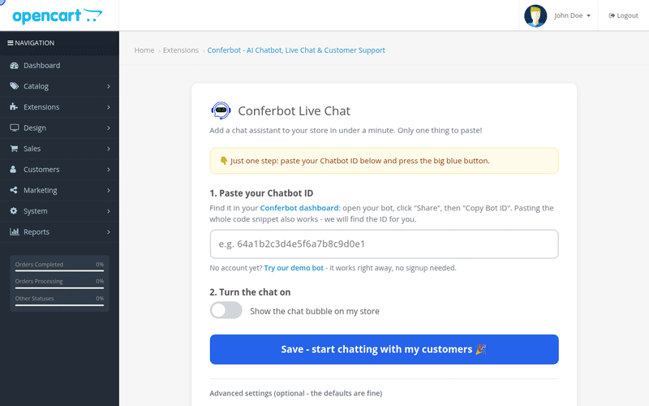

# Conferbot OpenCart Extension

Embeds the [Conferbot](https://conferbot.com) AI chat widget on an OpenCart 3.x store and passes the logged-in customer identity plus store/cart context to the bot.

## See it in action

Paste the Chatbot ID, flip the switch, and the bot is live on the storefront - 30 seconds end to end:



[HD video (MP4)](docs/demo.mp4) - also attached to the [latest release](https://github.com/Conferbot/conferbot-opencart/releases).

## How it works

The extension registers two OpenCart events. `catalog/view/common/header/after` injects the standard Conferbot loader before `</head>` on every storefront page; `catalog/controller/checkout/success/before` keeps the order just placed so the success page can report it. The widget script loads without blocking the page, and `ConferbotWidget` is called once it has loaded:

```html
<script>
  (function (d, s, id) {
    var js = d.createElement(s); js.async = true; js.id = id;
    js.src = "https://cdn.conferbot.com/dist/v1/widget.min.js";
    d.head.appendChild(js);
    js.onload = function () {
      window.ConferbotWidget("<CHATBOT_ID>", "live_chat", {
        user:       { id: "oc-7", name, email, hash },   // logged-in customer, if any
        customData: { platform: "opencart", storeName, storeUrl,
                      storeLanguage, storeCurrency, cartTotal, cartItemCount }
      });
      // On the checkout success page, once per order:
      window.ConferbotWidget.track("purchase", { value, currency, order_id });
    };
  })(document, "script", "conferbot-js");
</script>
```

The only credential needed is the **Chatbot ID**. Everything visitors see is set per bot in the Conferbot dashboard and delivered at runtime, with nothing to configure in OpenCart: flows and AI agents, live chat with handover to your team (queue position, leave a message when nobody is free, read receipts, file sharing, post-chat rating), the home screen, themes and dark mode, colours, launcher and mascot, greetings, languages and disabled URLs. The extension does not duplicate those settings.

### Identity verification (optional)

With a secret from Conferbot (workspace settings > Security > Identity verification) pasted under Advanced settings, each logged-in customer is sent with `hash = HMAC-SHA256(secret, user.id)`, computed on your server. Conferbot then trusts their name and email and can link their chats to their contact. The secret is stored in your OpenCart settings and never sent to the browser. Without it, the customer's details are still passed but marked unverified, and if your workspace *requires* verification they are dropped.

### Sales tracking

The checkout success page reports the customer's own order (`purchase`, with value, currency and order number) once per order, and every AJAX add-to-cart as `add_to_cart`. Conferbot credits a sale to a chat that happened within the week before it. A store that upgraded in place gets the second event the next time the settings page is opened.

`options.user` and `options.customData` become the visitor's identity/context in Conferbot chats, so the bot and human agents see the customer's name, email, cart total, and store details.

## Requirements

- OpenCart 3.0.x (verified on 3.0.3.9 with PHP 8.1). OpenCart 4 is not supported yet.
- PHP 7.2+
- A Conferbot account with a published chatbot (or use the built-in demo bot to try it first)

## Installation

1. Zip the contents of this repository (the zip must contain the `upload/` directory at its top level) and name it `conferbot.ocmod.zip`.
2. In the OpenCart admin, go to **Extensions > Installer** and upload the zip.
3. Go to **Extensions > Extensions**, choose the **Modules** type, find **Conferbot** and click **Install** (the green plus). Installing registers the storefront event.
4. Click **Edit** to open the configure screen.

## Configuration

The configure screen is two steps: paste your Chatbot ID, flip the switch, save. You can paste the bare ID, the full embed snippet, or a dashboard URL - the extension extracts the ID for you.

**No account yet?** Click "Try our demo bot" on the configure screen. It fills in the public demo bot (`691c970890527a0468f9b2c9`), which works out of the box so you can see the widget live before signing up.

| Setting | Description |
|---|---|
| Chatbot ID | Required. In the Conferbot dashboard open your bot, go to **Share > Embed** and copy the code; the extension finds the 24-character ID in it. |
| Identity verification secret | Optional. Signs logged-in customers so Conferbot can trust them. Write-only: shown as saved, never displayed. *(Advanced)* |
| Turn the chat on | Master on/off switch. |
| How the chat appears | Floating chat bubble (default) or popup window. *(Advanced)* |
| Widget script URL | Leave as is for the Conferbot CDN. Useful for staging/self-hosted widget builds. *(Advanced)* |

## Architecture

The controllers only wire OpenCart (settings form, event handler); the logic lives in a small, individually tested library class:

```
conferbot-opencart/
├── upload/
│   ├── admin/
│   │   ├── controller/extension/module/conferbot.php   # Settings screen + install()/uninstall() event wiring
│   │   ├── language/en-gb/extension/module/conferbot.php
│   │   ├── view/template/extension/module/conferbot.twig # Two-step configure UI
│   │   └── view/image/conferbot/logo.png
│   ├── catalog/
│   │   └── controller/extension/module/conferbot.php   # injectWidget() event handler (header/after)
│   └── system/
│       └── library/conferbot/loader.php                # Bot ID parsing/validation, widget options, loader snippet
├── tests/                                              # PHPUnit suite (not shipped in the zip)
├── phpunit.xml
├── LICENSE
└── README.md
```

Storefront injection uses OpenCart's event system (`setting/event` model, code `conferbot`, trigger `catalog/view/common/header/after`, action `extension/module/conferbot/injectWidget`) - no OCMOD file modifications, so it never conflicts with theme or vQmod/OCMOD edits to `header.php`.

Settings are stored under the `module_conferbot` code: `module_conferbot_status`, `module_conferbot_bot_id`, `module_conferbot_embed_type`, `module_conferbot_script_url`.

## Tests

20 PHPUnit tests (73 assertions) cover bot ID extraction (bare ID, full snippet, dashboard URL, garbage, empty), strict validation, widget option building (guest/customer/cart variants, type casting), the identity hash and write-only secret, the purchase event, script-injection safety of the inlined JSON, and loader snippet rendering. The suite runs without an OpenCart installation - `ConferbotLoader` is a pure PHP class.

```bash
# any PHP 7.2+ with phpunit 9:
phpunit

# or containerized:
docker run --rm -v "$PWD":/mod -v /path/to/phpunit-9.phar:/phpunit.phar:ro \
  -w /mod php:8.2-cli php /phpunit.phar
```

## Manual verification

1. Save the configuration with a valid Chatbot ID (or the demo bot).
2. Open the storefront - the chat bubble should appear (subject to the bot's own dashboard settings such as disabled URLs and load delay).
3. Log in as a customer and start a chat: the conversation in the Conferbot inbox should show the customer's name/email and cart context.

## Notes & limitations

- No API key or workspace ID is required - the widget resolves everything server-side from the Chatbot ID over Socket.IO (`wdt.conferbot.com`).
- Outbound webhooks (order status, product updates, abandoned cart) are **not** part of this version; the Conferbot backend does not yet expose OpenCart webhook endpoints.
- If the widget does not appear: check the module is installed **and** enabled on the configure screen, the Chatbot ID is correct and the bot is published/not disabled, the `conferbot` event exists and is enabled under **Extensions > Events**, and clear the theme/SASS caches under **Dashboard > gear icon > Refresh**.

## License

GNU General Public License v3.0 or later (GPL-3.0-or-later) - see [LICENSE](LICENSE). This follows the OpenCart marketplace convention (OpenCart itself is GPLv3).
